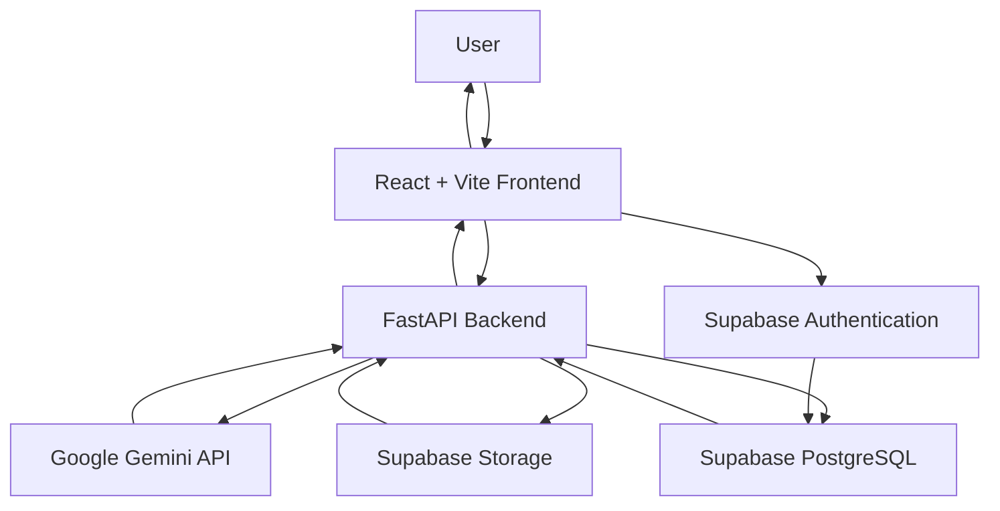

# CreateX AI 🚀
### Your AI-Powered Creative Campaign Workspace

**From a campaign idea to a complete creative workflow — powered by AI.**

CreateX AI is an AI-powered campaign creation platform designed to help users transform ideas into structured marketing campaigns and creative assets through a unified workspace.

Instead of switching between multiple tools for brainstorming, campaign planning, visual creation and social content, CreateX AI brings these workflows together in one place.

---

## 📌 Table of Contents

- [Overview](#-overview)
- [Problem Statement](#-problem-statement)
- [Our Solution](#-our-solution)
- [Key Features](#-key-features)
- [How CreateX AI Works](#-how-createx-ai-works)
- [Who Can Use CreateX AI](#-who-can-use-createx-ai)
- [Technology Stack](#-technology-stack)
- [System Architecture](#-system-architecture)
- [AI Integration](#-ai-integration)
- [Authentication and Data Management](#-authentication-and-data-management)
- [Security and Privacy](#-security-and-privacy)
- [Project Structure](#-project-structure)
- [Getting Started](#-getting-started)
- [Environment Configuration](#-environment-configuration)
- [Running Locally](#-running-locally)
- [API Documentation](#-api-documentation)
- [Testing and Validation](#-testing-and-validation)
- [Current Limitations](#-current-limitations)
- [Future Scope](#-future-scope)
- [Why CreateX AI](#-why-createx-ai)
- [Acknowledgements](#-acknowledgements)

---

## 🌟 Overview

Creating a successful marketing campaign involves much more than writing a caption or designing a poster.

It requires:

- Understanding the campaign objective.
- Developing a creative direction.
- Planning content.
- Creating visual assets.
- Preparing social media content.
- Organizing the entire campaign.

These activities are often spread across different applications and workflows.

**CreateX AI aims to simplify this process by bringing AI-assisted campaign planning and creative production into one unified workspace.**

The platform combines an interactive React frontend, a FastAPI backend, Google's Gemini AI services and Supabase-powered authentication and data storage.

The goal is simple:

> Make campaign creation more organized, accessible and efficient by bringing the creative workflow into one AI-powered platform.

---

## ❗ Problem Statement

Individuals, creators, student entrepreneurs and small teams often face difficulties when developing marketing campaigns.

### 1. Fragmented workflows

Campaign planning, visual design, copywriting and content organization frequently happen in separate tools.

### 2. Time-consuming creative processes

Developing a campaign from scratch requires multiple rounds of brainstorming, planning and content preparation.

### 3. Difficulty maintaining consistency

When different campaign elements are created separately, maintaining a consistent message and creative direction becomes difficult.

### 4. Technical and creative barriers

Not everyone has access to professional creative tools or the experience required to develop structured marketing content.

### 5. Disorganized campaign management

Ideas and generated assets can become scattered across documents, folders and applications.

These challenges create unnecessary friction between having an idea and turning that idea into a usable campaign.

---

## 💡 Our Solution

CreateX AI provides a unified AI-assisted environment for campaign creation.

Users can begin with a campaign idea, generate structured campaign content and continue working with the generated material through dedicated creative studios.

The platform is designed around three principles:

**1. Simplicity**

A straightforward workflow that helps users move from an idea to campaign content.

**2. Integration**

Campaign planning and creative workflows are organized inside one application.

**3. Accessibility**

Guest access and account-based access provide different ways to use the platform.

CreateX AI is not intended to replace human creativity. It is designed to support it by reducing repetitive work and helping users develop their ideas.

---

## ✨ Key Features

### 1. AI Campaign Generation

Create campaign content using AI-powered text generation.

The campaign generation workflow uses Google's Gemini API to help transform user-provided ideas and requirements into structured campaign content.

### 2. Unified Creative Workspace

A centralized workspace helps users organize and continue working on their generated campaigns.

The workspace includes dedicated creative areas:

| Studio | Purpose |
|---|---|
| Poster Studio | Work with campaign poster assets |
| Storyboard Studio | Organize visual storytelling concepts |
| Social Studio | Work with social media campaign content |
| Campaign Overview | Review and organize campaign information |

### 3. Poster Generation

The platform includes an AI-powered visual generation workflow for creating campaign-related imagery.

Image generation availability depends on the configured model and its current API quota.

### 4. Campaign Persistence

Campaign information and generated assets can be saved through the backend and Supabase integration.

This supports continuity between sessions instead of treating every interaction as a temporary activity.

### 5. User Authentication

Users can access the platform through guest functionality or account-based authentication.

Authenticated users receive user-specific access to their stored projects.

### 6. Guest Mode

Users can explore supported functionality without immediately creating an account.

Guest sessions are identified separately from authenticated users.

### 7. Asset Storage

Generated assets can be uploaded to Supabase Storage and retrieved through their stored references.

### 8. Responsive Interface

The frontend is designed to support desktop and mobile layouts, including dedicated mobile navigation.

### 9. Export Support

The workspace includes Markdown and JSON export functionality for supported campaign information.

### 10. Generation Feedback

The interface provides visual feedback during campaign generation to make the process easier to follow.

---

## 🔄 How CreateX AI Works

The platform follows a simple workflow.

**Step 1 — Start with an idea**

The user enters a campaign concept and the information required to describe the campaign.

**Step 2 — Generate campaign content**

The frontend sends the request to the FastAPI backend.

**Step 3 — AI processing**

The backend communicates with the configured Gemini text model to generate campaign content.

**Step 4 — Review the results**

The generated campaign information is returned to the frontend.

**Step 5 — Enter the creative workspace**

The user can work with the campaign through the available studios.

**Step 6 — Generate or manage visual assets**

Where image generation is available, the visual generation workflow processes the request and handles the resulting asset.

**Step 7 — Save campaign information**

Campaign information and supported generated assets can be persisted using Supabase.

**Step 8 — Continue working**

Users can return to saved campaigns through the application's supported project retrieval workflow.

---

## 👥 Who Can Use CreateX AI?

CreateX AI is designed to support:

- Student entrepreneurs developing business ideas.
- Content creators planning campaigns.
- Small businesses preparing marketing content.
- Startup teams developing promotional campaigns.
- Individuals exploring creative concepts.
- People who want an organized starting point for campaign development.

### Example Use Cases

**Startup Launch Campaign**

A startup can develop a campaign concept and prepare supporting marketing content.

**Product Promotion**

A small business can organize promotional messaging and campaign visuals.

**Social Media Campaign**

A creator can develop campaign content and organize it through the social studio.

**Event Promotion**

An event organizer can develop a campaign around an event and prepare supporting creative material.

---

## 🛠️ Technology Stack

CreateX AI uses a full-stack architecture.

| Layer | Technology | Responsibility |
|---|---|---|
| Frontend | React | User interface |
| Build Tool | Vite | Frontend development and build |
| Styling | Tailwind CSS | Responsive styling |
| Backend | Python | Application backend |
| API Framework | FastAPI | REST API endpoints |
| Text AI | Google Gemini | AI-powered text generation |
| Image AI | Gemini image model | AI visual generation |
| Database | Supabase PostgreSQL | Structured data persistence |
| Authentication | Supabase Auth | User authentication |
| File Storage | Supabase Storage | Generated asset storage |
| Frontend Hosting | Vercel configuration | Frontend deployment |
| Backend Hosting | Render configuration | Backend deployment |

---

## 🏗️ System Architecture

CreateX AI follows a frontend-backend architecture with Supabase and external AI services.



### Architecture Explanation

**Frontend Layer**

The React application provides the interface for campaign creation, authentication, workspace navigation and asset management.

**Backend Layer**

FastAPI handles application requests, validates inputs, manages authentication context and coordinates communication with external services.

**AI Layer**

Gemini provides the configured AI text and image generation capabilities.

**Database Layer**

Supabase PostgreSQL stores structured application information.

**Authentication Layer**

Supabase Auth manages account-based authentication.

**Storage Layer**

Supabase Storage handles supported generated asset uploads and retrieval.

---

## 🧠 AI Integration

AI is a central part of CreateX AI.

The backend integrates with Google's Gemini API through the official Python SDK.

### Text Generation

The configured text-generation model is:

`gemini-3.1-flash-lite`

It is used for AI-assisted campaign content generation.

### Image Generation

The configured image-generation model is:

`gemini-2.5-flash-image`

It is used by the visual generation workflow.

### AI Request Flow

1. The user submits a generation request.
2. The frontend sends the request to FastAPI.
3. The backend validates the request.
4. The appropriate Gemini model is called.
5. The backend processes the model response.
6. The result is returned to the frontend.
7. Supported results can be saved through the persistence workflow.

### AI Reliability

AI services may have usage limits, model availability restrictions and quota errors.

CreateX AI includes error handling for generation failures so that temporary AI service limitations can be communicated instead of being treated as successful generation.

---

## 🔐 Authentication and Data Management

CreateX AI integrates Supabase for authentication and data persistence.

### Authentication Modes

**Guest Mode**

- Uses a guest session identifier.
- Allows supported functionality without account registration.
- Keeps guest data separated from authenticated user data.

**Authenticated Mode**

- Uses Supabase authentication.
- Sends the user's access token with protected API requests.
- Associates stored projects with the authenticated user.

### Data Ownership

The backend applies ownership checks when accessing user-specific resources.

The application distinguishes between:

- Authenticated user-owned projects.
- Guest-session projects.
- Resources belonging to other users.

Requests that attempt to access another user's private project are rejected.

### Data Storage

Supabase is used for:

- User profiles.
- Campaign projects.
- Generated asset metadata.
- Generated asset files through Supabase Storage.

---

## 🛡️ Security and Privacy

Security is an important part of the CreateX AI architecture.

The project includes the following security measures:

### Backend-Only Secrets

Privileged credentials, including the Supabase service-role key and Gemini API key, belong on the backend.

They must never be exposed through frontend environment variables or committed to the public repository.

### Authentication Validation

Protected requests use verified authentication rather than trusting arbitrary user-supplied identifiers.

Invalid or expired authentication tokens are rejected.

### Ownership Enforcement

The backend checks whether a requested resource belongs to the authenticated user or the relevant guest session.

### Guest Isolation

Guest data is associated with a validated session identifier rather than being treated as authenticated user data.

### Rate Limiting

The backend includes rate-limiting functionality for sensitive generation endpoints.

The implementation includes configurable limits for guest and authenticated requests.

A PostgreSQL-backed rate-limiting implementation has also been developed, but its real database concurrency tests still require an isolated database test environment.

### CORS

The backend uses an explicit allowed-origin configuration to control which frontend origins can make browser requests.

### Storage Validation

The storage workflow validates supported file types and upload constraints.

The public `createx-posters` bucket is intended for public marketing artwork, not confidential user documents.

---

## 📁 Project Structure

The repository is organized into frontend, backend and database components.

```text
CreateX/
│
├── backend/
│   ├── app/
│   │   ├── api/
│   │   │   └── routes/
│   │   ├── core/
│   │   ├── schemas/
│   │   └── services/
│   │
│   ├── tests/
│   ├── main.py
│   ├── requirements.txt
│   └── Dockerfile
│
├── frontend/
│   ├── src/
│   │   ├── components/
│   │   │   ├── auth/
│   │   │   ├── layout/
│   │   │   └── workspace/
│   │   │
│   │   ├── context/
│   │   ├── pages/
│   │   ├── services/
│   │   └── App.jsx
│   │
│   ├── package.json
│   └── vercel.json
│
├── database/
│   ├── schema.sql
│   └── migrations/
│
├── docs/
│   ├── API.md
│   ├── ARCHITECTURE.md
│   ├── SUPABASE_SETUP.md
│   └── PROJECT_RULES.md
│
└── README.md
```

---

## 🚀 Getting Started

Follow these instructions to run CreateX AI locally.

### Prerequisites

Install the following:

- Python 3.10 or a compatible version supported by the backend dependencies.
- Node.js and npm.
- Git.
- A Supabase project.
- A Gemini API key for AI features.

### 1. Clone the Repository

```bash
git clone https://github.com/Jit2005git/CreateX.git
```

Move into the project directory:

```bash
cd CreateX
```

### 2. Configure the Backend

Move into the backend directory:

```bash
cd backend
```

Create a Python virtual environment:

```bash
python -m venv .venv
```

Activate it.

**Windows PowerShell:**

```powershell
.venv\Scripts\Activate.ps1
```

**macOS/Linux:**

```bash
source .venv/bin/activate
```

Install dependencies:

```bash
pip install -r requirements.txt
```

### 3. Configure the Frontend

Open another terminal and move into the frontend directory:

```bash
cd frontend
```

Install dependencies:

```bash
npm install
```

### 4. Configure Environment Variables

Create the backend and frontend `.env` files using the configuration described below.

Do not commit actual `.env` files to GitHub.

### 5. Configure Supabase

Set up the Supabase project using the database schema and instructions provided in the repository.

Apply the required SQL schema and migrations before testing database-dependent functionality.

### 6. Start the Backend

From the backend directory:

```bash
uvicorn main:app --host 127.0.0.1 --port 8000 --reload
```

### 7. Start the Frontend

From the frontend directory:

```bash
npm run dev
```

### 8. Open the Application

Frontend:

```text
http://localhost:5173
```

Backend:

```text
http://127.0.0.1:8000
```

API documentation:

```text
http://127.0.0.1:8000/docs
```

---

## ⚙️ Environment Configuration

Create two separate environment files.

### Backend: `backend/.env`

Use the following variable structure:

```env
APP_ENV=development

GEMINI_API_KEY=your_gemini_api_key
GEMINI_TEXT_MODEL=gemini-3.1-flash-lite
GEMINI_IMAGE_MODEL=gemini-2.5-flash-image

SUPABASE_URL=your_supabase_project_url
SUPABASE_SERVICE_ROLE_KEY=your_supabase_service_role_key
SUPABASE_ANON_KEY=your_supabase_anon_key
SUPABASE_JWT_SECRET=your_supabase_jwt_secret

SUPABASE_STORAGE_BUCKET=createx-posters

RATE_LIMIT_STORE=memory
RATE_LIMIT_ENABLED=true
ALLOW_TEST_TOKENS=false
```

### Frontend: `frontend/.env`

```env
VITE_API_BASE_URL=http://127.0.0.1:8000

VITE_SUPABASE_URL=your_supabase_project_url
VITE_SUPABASE_ANON_KEY=your_supabase_anon_key
```

**Important security notes:**

- Never commit `.env` files.
- Never put the Supabase service-role key in the frontend.
- Never expose the Gemini API key to the browser.
- Only public Supabase credentials belong in the frontend.
- Use the exact variable names expected by the current application configuration.
- Restart the frontend and backend after changing environment variables.

---

## 📡 API Documentation

The backend is built using FastAPI.

During local development, interactive API documentation is available at:

```text
http://127.0.0.1:8000/docs
```

The application includes API workflows for campaign generation, visual generation, authentication-aware requests, project persistence and asset management.

The exact available routes and request schemas can be inspected in the interactive Swagger documentation.

---

## 🧪 Testing and Validation

CreateX AI has undergone multiple development and testing phases.

The reported development checks include:

| Area | Reported validation |
|---|---|
| Campaign generation | Backend and frontend integration tests |
| Authentication | Supabase authentication integration tests |
| Guest sessions | Session isolation tests |
| User ownership | Cross-user access protection tests |
| Asset storage | Upload, retrieval and validation tests |
| Frontend | Production build checks |
| Responsive interface | Desktop and mobile browser checks |
| Security | Token validation and rate-limiting tests |
| API reliability | Error-handling and response checks |

### Reported Test Results

Across development phases, the project reports successful test runs including:

- 18/18 backend security checks.
- 17/17 storage checks.
- 13/13 proxy trust checks.
- 8/8 frontend authentication checks.
- 14/14 controlled deployment smoke checks.
- 14 simulated PostgreSQL rate-limiter checks.

These are results reported during development, not a claim that every test has been independently rerun on every installation.

**PostgreSQL rate-limiter note:** Real multi-connection database concurrency testing remains pending an isolated test database.

---

## ⚠️ Current Limitations

We believe in being transparent about the current state of the project.

### 1. AI Image Generation Quotas

Image generation depends on the configured Gemini image model and available API quota.

The application may return a quota or rate-limit error when the provider does not permit additional generation requests.

### 2. Backend Free-Tier Availability

The planned free-tier backend hosting configuration may introduce cold starts or temporary unavailability after periods of inactivity.

### 3. In-Memory Rate Limiting

The current MVP deployment configuration uses in-memory rate limiting.

This is suitable for a limited single-instance prototype but does not provide shared rate-limit state across multiple backend instances or survive process restarts.

### 4. PostgreSQL Rate-Limiter Verification

The PostgreSQL-backed implementation has been developed, but its real database concurrency test suite has not yet been executed against an isolated test database.

### 5. Deployment Status

Deployment configuration has been prepared for Vercel, Render and Supabase.

Preparation and local smoke tests should not be confused with a completed public production deployment.

---

## 🔮 Future Scope

CreateX AI can be expanded in several directions.

### 1. More Advanced Campaign Intelligence

Improve campaign personalization and generate more context-aware recommendations.

### 2. Expanded Creative Formats

Add more creative formats and campaign deliverables.

### 3. Improved Visual Generation

Improve image generation reliability, asset variation and creative controls as suitable model access becomes available.

### 4. Campaign Collaboration

Introduce collaborative workflows that allow multiple users to work on campaigns together.

### 5. Analytics and Performance Insights

Provide campaign performance insights and content-level analytics.

### 6. Improved Asset Management

Introduce richer asset organization, search and version management.

### 7. Production-Grade Infrastructure

Introduce distributed rate limiting, improved monitoring and stronger deployment reliability as the platform grows.

---

## 🏆 Why CreateX AI?

CreateX AI focuses on an important gap in the creative process: the distance between having a campaign idea and organizing it into usable marketing content.

Its value comes from bringing multiple parts of that process together.

| Challenge | CreateX AI Approach |
|---|---|
| Starting from scratch | AI-assisted campaign generation |
| Fragmented creative work | Unified workspace |
| Managing campaign content | Campaign persistence |
| Preparing visual material | Poster and visual workflows |
| Organizing social content | Dedicated social studio |
| Managing access | Guest mode and Supabase authentication |
| Maintaining continuity | Saved projects and assets |

**Our vision is to make creative campaign development more accessible, structured and AI-assisted.**

---

## 🙌 Acknowledgements

CreateX AI is built using open-source technologies and external developer services.

We would like to acknowledge:

- Google Gemini for AI capabilities.
- Supabase for authentication, database and storage services.
- React and Vite for frontend development.
- FastAPI and Python for backend development.
- Tailwind CSS for interface styling.
- The open-source developer community.

---

## 👨‍💻 Project Information

**Project:** CreateX AI  
**Repository:** https://github.com/Jit2005git/CreateX  
**Category:** AI / Creative Technology / Marketing  
**Development Stage:** MVP  

**Team:** CHATUSH_CODE401
**Hackathon:** GeNarrative Clash
**Live Demo:** [Add public demo URL when deployed]  
**Demo Video:** [Add demo video URL if available]

---

## ⭐ Final Note

CreateX AI is built around one simple idea:

**Creativity should begin with an idea, not with the difficulty of managing multiple tools.**

By combining AI-assisted generation, a unified creative workspace and integrated project management, CreateX AI aims to make the journey from concept to campaign more organized and accessible.

Thank you for exploring CreateX AI! 🚀
