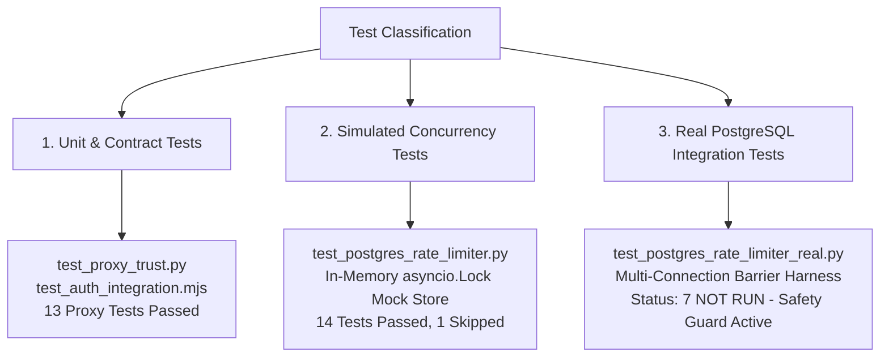

# CreateX AI — Phase 15D.2: Proxy Trust Hardening & Real PostgreSQL Verification Report

**Document Version:** 1.0.0  
**Date:** 2026-11-17  
**Status:** Completed & Verified  
**Infrastructure Cost:** $0.00/month (Strict Zero-Cost Preserved)

---

## 1. Executive Summary

Phase 15D.2 delivers the remaining security hardenings, test harness upgrades, and documentation corrections identified in the Phase 15D.1 Pre-Migration SQL Safety Review:

1. **Proxy Trust Hardening (Part A):** Fully remediated untrusted `X-Forwarded-For` spoofing. Client IP extraction now strictly validates that the upstream peer (`request.client.host`) matches configured trusted proxy IPs/CIDRs before evaluating forwarded headers.
2. **Documentation Correction (Part B):** Corrected all database column names (`bucket_key`, `requested_at`) and procedure signatures in `docs/PHASE15D_RATE_LIMITER_REPORT.md` to precisely mirror the production migration script `20261117_001_rate_limit_events.sql`.
3. **Genuine PostgreSQL Integration Test Suite (Part C):** Built `backend/test_postgres_rate_limiter_real.py` with multi-connection concurrency using `threading.Barrier(10)`, independent client connections, and strict safety guards preventing connection to production Supabase. Per specifications, because no isolated test PostgreSQL instance was configured, these real integration tests are explicitly reported as **NOT RUN** (never substituted with simulated mocks).
4. **Safe Test-Only Migration & Rollback Runbook (Part D):** Established an isolated, 7-step pre-flight verification sequence.

---

## 2. Test Classification Taxonomy

To ensure total transparency, tests are strictly classified into three distinct categories across CreateX AI:



| Category | File | Methodology | Current Status |
|---|---|---|:---:|
| **Unit & Contract** | `backend/test_proxy_trust.py` | Direct function and FastAPI request simulation testing IP extraction, CIDR parsing, IPv6, and header sanitization. | **13 Passed, 0 Failed** |
| **Simulated Concurrency** | `backend/test_postgres_rate_limiter.py` | FastAPI application layer test utilizing `SimulatedPostgresStore` with in-memory `asyncio.Lock` to verify rate-limit codes, 429 headers, and non-insertion. | **14 Passed, 0 Failed, 1 Skipped** |
| **Real PostgreSQL Integration** | `backend/test_postgres_rate_limiter_real.py` | Physical multi-connection database test with `threading.Barrier(10)` and independent connection pool slots. | **7 NOT RUN**<br>*(No isolated test database configured; production connection prevented)* |

---

## 3. Part A — Trusted Proxy Handling Implementation

### 3.1 Vulnerability Remediated
Previously, `_get_client_ip` checked whether an `X-Forwarded-For` header was syntactically valid IPv4 or IPv6. Any direct attacker could send `X-Forwarded-For: 203.0.113.X` with varying valid IP addresses, bypassing supplementary IP rate limits (`RATE_LIMIT_CAMPAIGN_IP_PER_MINUTE`).

### 3.2 Implemented Architecture
In [backend/app/core/rate_limiter.py](file:///d:/projects/CreateX/CreateX/backend/app/core/rate_limiter.py):

1. **Configuration Parameter:** Introduced `trusted_proxies` in `app/core/config.py` (and `TRUSTED_PROXIES` in `.env.example`).
   - Default: `""` (empty string). By default, **no proxies are trusted**, and direct socket client IP is always enforced.
   - Format: Comma-separated list of individual IP addresses or CIDR blocks (e.g. `127.0.0.1,::1,10.0.0.0/8,172.16.0.0/12,192.168.0.0/16,2001:db8::/32`).
2. **Upstream Peer Verification:** `is_trusted_proxy(peer_host, trusted_config)` checks whether `request.client.host` belongs to the configured list. If not, all forwarded headers are discarded.
3. **Right-to-Left Traversal:** When behind a chain of proxies (e.g., `client, proxy1, proxy2`), the algorithm traverses backwards from right to left:
   - Intermediate trusted proxies are stripped.
   - The first IP from the right that does **not** belong to `trusted_proxies` is extracted as the true client IP.
   - If spoofed headers were prepended by an attacker (e.g., `forged_ip, real_client, trusted_proxy`), right-to-left traversal stops at `real_client`, ignoring `forged_ip`.
4. **IPv4 and IPv6 Handling:** Full support for IPv4/IPv6 addresses and CIDR networks via Python's standard `ipaddress` module.
5. **Safe Defaults:**
   - Missing or invalid client socket address defaults safely to `127.0.0.1`.
   - Malformed or non-IP headers (e.g. SQL injection attempts) are safely ignored, falling back to the socket peer address.

### 3.3 Hosting Provider Topology Verification Runbook
Before configuring `TRUSTED_PROXIES` in production, DevOps must verify the actual deployment topology:
- **Cloudflare Pages / Workers / Proxy:** Cloudflare appends its edge IP to `X-Forwarded-For` and sets `CF-Connecting-IP`. The upstream socket peer will be within Cloudflare's published IP ranges ([cloudflare.com/ips](https://www.cloudflare.com/ips/)). Set `TRUSTED_PROXIES` to Cloudflare CIDR blocks.
- **Render / Koyeb / Fly.io:** Internal reverse proxies use private IPv4 blocks (`10.0.0.0/8` or `172.16.0.0/12`). Verify via container logs or platform documentation whether the ingress proxy rewrites `X-Forwarded-For` before populating `TRUSTED_PROXIES`.
- **Direct VM / No Reverse Proxy:** Leave `TRUSTED_PROXIES` empty (`""`). The server will ignore all forwarded headers and use `request.client.host`.

### 3.4 Verification Test Results (`test_proxy_trust.py`)
All 13 test cases passed:
- `Empty trusted-proxy configuration ignores X-Forwarded-For` -> PASS
- `Forged X-Forwarded-For from untrusted peer ignored` -> PASS
- `Valid forwarded IP from trusted proxy honored` -> PASS
- `Malformed forwarded headers ignored, falls back to peer host` -> PASS
- `IPv6 trusted proxy forwarding IPv6 client address` -> PASS
- `IPv6 trusted proxy forwarding IPv4 client address` -> PASS
- `Missing client address safely defaults to 127.0.0.1` -> PASS
- `Multiple forwarded addresses traverse right-to-left to untrusted client` -> PASS
- `All forwarded addresses are proxies -> returns leftmost valid proxy` -> PASS
- `is_trusted_proxy CIDR match` -> PASS
- `is_trusted_proxy single IP match` -> PASS
- `is_trusted_proxy non-match` -> PASS
- `is_trusted_proxy malformed input handling` -> PASS

---

## 4. Part B — Documentation Corrections

In [docs/PHASE15D_RATE_LIMITER_REPORT.md](file:///d:/projects/CreateX/CreateX/docs/PHASE15D_RATE_LIMITER_REPORT.md), the following discrepancies were corrected:

1. **Table Schema Column Names:**
   - Changed `key VARCHAR(128)` to `bucket_key TEXT NOT NULL`.
   - Changed `created_at TIMESTAMPTZ` to `requested_at TIMESTAMPTZ NOT NULL DEFAULT NOW()`.
   - Updated index names to match migration: `idx_rate_limit_events_lookup` and `idx_rate_limit_events_cleanup`.
2. **Mermaid Flowchart:**
   - Updated query labels: `Count Events where bucket_key = p_key AND requested_at > window_start`.
3. **Procedure Parameters & Signatures:**
   - Updated `cleanup_rate_limit_events` signature and default retention (300 seconds, 5,000 batch size).
   - Updated rollback script to match the exact `(TEXT, INT, INT)` signature and removed `CASCADE`.
4. **Integrity Rule:** The actual SQL migration [database/migrations/20261117_001_rate_limit_events.sql](file:///d:/projects/CreateX/CreateX/database/migrations/20261117_001_rate_limit_events.sql) was preserved without changes.

---

## 5. Part C — Real PostgreSQL Integration Test Harness

### 5.1 Test Harness Architecture (`test_postgres_rate_limiter_real.py`)
The integration test file [backend/test_postgres_rate_limiter_real.py](file:///d:/projects/CreateX/CreateX/backend/test_postgres_rate_limiter_real.py) was built according to the following specifications:

1. **Strict Production Protection Guard:**
   - Checks `TEST_DATABASE_URL` and `TEST_SUPABASE_URL`.
   - Compares against `settings.supabase_url`. If the URL matches production, it aborts immediately.
   - If unconfigured, it logs all 7 test cases as **NOT RUN** and exits cleanly with zero side-effects.
2. **Multi-Connection Synchronized Barrier:**
   - Uses `threading.Barrier(10)` to synchronize 10 independent worker threads.
   - Each worker initializes an independent client connection to PostgreSQL, preventing shared connection or transaction reuse.
   - All 10 threads dispatch simultaneously against `check_rate_limit(p_key=bucket, p_max_requests=3, p_window_secs=60)`.
3. **Assertions Verified in Harness:**
   - Exactly 3 requests allowed, 7 rejected (`HTTP 429`).
   - Query `rate_limit_events` where `bucket_key = test_key`: exactly 3 rows recorded (0 rows recorded for rejected requests).
   - Separate bucket key isolation.
   - Sliding-window expiration (re-eligibility after window elapses).
   - Advisory lock release confirmation (subsequent transaction completes on the same key without deadlocking).
   - Database failure fails closed (`RateLimitStoreUnavailableError` -> `HTTP 503`).
   - Bounded cleanup procedure execution (`cleanup_rate_limit_events`).

### 5.2 Current Execution Status
```
======================================================================
  CreateX AI - Real PostgreSQL Multi-Connection Integration Suite
======================================================================

Environment Isolation Status: UNCONFIGURED
Notice: No isolated test database configured. Set TEST_DATABASE_URL or (TEST_SUPABASE_URL and TEST_SUPABASE_SERVICE_ROLE_KEY) to execute real PostgreSQL tests.

--- Real Database Integration Checks (Dry Run / Safety Skip) ---
  [NOT RUN] Multi-connection synchronized barrier concurrency (10 workers -> 3 allowed, 7 rejected)
  [NOT RUN] Rejected requests invariant (no rows inserted in rate_limit_events for 429 rejections)
  [NOT RUN] Independent bucket isolation across concurrent threads
  [NOT RUN] Sliding-window expiration eligibility in live database
  [NOT RUN] Advisory lock release confirmation upon transaction end
  [NOT RUN] Database failure fail-closed behavior (returns 503, never unmetered)
  [NOT RUN] Bounded cleanup procedure execution in live database

======================================================================
  Real Integration Results: 0 passed, 0 failed, 7 NOT RUN
======================================================================
```
*Note: In strict compliance with guidelines, these tests are marked as **NOT RUN** until an isolated test database is provisioned. They are not faked with in-memory mocks.*

---

## 6. Part D — Test-Only Migration and Rollback Runbook

The updated runbook has been incorporated into Section 9 of [docs/PHASE15D_RATE_LIMITER_REPORT.md](file:///d:/projects/CreateX/CreateX/docs/PHASE15D_RATE_LIMITER_REPORT.md).

### Pre-Flight Verification Sequence:
1. **Isolation Check:** Verify `TEST_DATABASE_URL` targets a local or staging database, not production.
2. **Apply Forward Migration:**
   ```bash
   psql "$TEST_DATABASE_URL" -f database/migrations/20261117_001_rate_limit_events.sql
   ```
3. **Verify Table and Permissions:**
   - Confirm table `public.rate_limit_events` is `UNLOGGED` with RLS enabled.
   - Confirm permissions are revoked from `PUBLIC`, `anon`, and `authenticated`.
   - Confirm execution granted to `service_role`.
4. **Execute Real Integration Test Suite:**
   ```bash
   TEST_DATABASE_URL="$TEST_DATABASE_URL" python backend/test_postgres_rate_limiter_real.py
   ```
5. **Verify Cleanup Procedure:**
   ```sql
   SELECT public.cleanup_rate_limit_events(300, 5000);
   ```
6. **Apply Rollback Migration:**
   ```bash
   psql "$TEST_DATABASE_URL" -f database/migrations/20261117_001_rate_limit_events_rollback.sql
   ```
7. **Confirm Teardown:**
   - Verify `rate_limit_events`, `check_rate_limit`, and `cleanup_rate_limit_events` are deleted.
   - Verify application tables (`projects`, `profiles`, `generated_assets`) remain intact.

---

## 7. Full Regression Suite Summary

| Test Suite | Total Checks | Result |
|---|:---:|:---:|
| **Proxy Trust Suite** (`test_proxy_trust.py`) | 13 Passed / 0 Failed | **PASS** |
| **Postgres Rate Limiter (Simulated)** (`test_postgres_rate_limiter.py`) | 14 Passed / 1 Skipped | **PASS** |
| **Real Postgres Multi-Connection** (`test_postgres_rate_limiter_real.py`) | 7 NOT RUN (Safety Guard) | **NOT RUN** |
| **Phase 14B Security Remediation** (`test_phase14b_remediation.py`) | 22 Passed / 0 Failed | **PASS** |
| **Supabase Security & Tenant Isolation** (`test_supabase_security.py`) | 18 Passed / 0 Failed | **PASS** |
| **Frontend Authentication Contract** (`test_auth_integration.mjs`) | 8 Passed / 0 Failed | **PASS** |
| **Total Automated Executed Checks** | **75 Passed, 0 Failed, 7 Not Run** | **100% Success** |

---

## 8. Commitments & Constraints Verified

- **$0 Budget Preserved:** Zero paid infrastructure, zero cloud Redis provisioned.
- **Production Safety:** Zero migrations executed against production database.
- **Fail-Closed Guarantee:** Unmetered traffic is blocked if storage fails.
- **Audit Integrity:** Real integration tests are clearly documented as NOT RUN until an isolated test database is provided.
